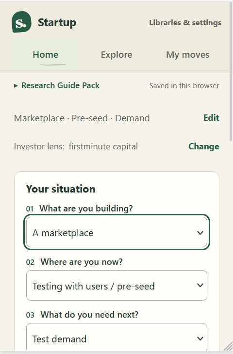

# Startup Guide

Choose a small next experiment, understand why it may help, and record what you learn.

## Watch a research example

**Your situation → investor lens → startup example → inspect the evidence.**

The recording follows **Marketplace · Pre-seed · Demand**, selects **firstminute capital**, then opens **Try a bounded local service** and its DoorDash source. It is explicitly **startup-only**: the pack does not document a matching firstminute interest or a relationship between the two organizations.

[Follow the research walkthrough](GUIDE.md#try-a-researched-example) · [Open the animation](assets/research-walkthrough.gif)

## Try it

Download this repository and open [index.html](index.html) in your browser. No installation, Node or Python needed.

1. **Describe your situation.** Choose your business model, stage and learning question, then **Show my options**. “Not sure yet” is fine.
2. **Review a next move.** Read the reason and inspect its examples or sources.
3. **Try it and learn.** Write what you’ll try and what you’ll look for. Save progress; expand the other fields when useful.

| Home | Explore | My moves |
| --- | --- | --- |
| Your next move and why | Investor perspectives and startup examples | Experiment plans and learning notes |

## Choose a Guide Pack

**Research is the default for new workspaces. Fictional demo scenarios are optional.**

| Included research | Try demo scenarios |
| --- | --- |
| Nine investor/program records and three historical startup snapshots; seven profiles are reference-only. | Entirely invented profiles and examples, kept separate from research. |
| Browse, compare and explore startup-only suggestions where an authored rule fits. No investor topics are currently documented. | Open **Libraries & settings → Try demo scenarios**, then choose Both connected, Investor interest only, Startup example only or Neither on Home. |

Existing saved library choices and plans are preserved. Choose **Use included research** in settings to switch. Custom packs still require preview and explicit activation; notes stay separate by library/version. [Guide and test scenarios](GUIDE.md#try-one-example).

Community providers supply three components in one v2 package: **research, matching criteria and suggestion content**. The companion **guide-pack-kit** is a reference authoring kit using LLM-assisted research and review. The app owns executable matching logic and does not call an LLM. Provider identity and quality claims are not independently verified. Legacy v1 packages still import.

## Know what it means

- **Your data stays in this browser.** Startup details, imported records and notes are stored locally; import does not upload them. External source links open only when followed.
- **Suggestions are experiments.** A match is not an investor endorsement, funding-readiness score or proof of what made another startup survive.
- **Unknowns stay unknown.** Missing facts or unsupported connections are not filled in automatically.

## Read more

| For using the app | For contributing |
| --- | --- |
| [Guide and methodology](GUIDE.md#methodology) | [Development and publishing](DEVELOPMENT.md) |
| [Research import and connection guide](GUIDE_PACKS.md) | [Research connection authoring](GUIDE_PACKS.md#authoring-research-connections) |
| [Fictional library overview](GUIDE.md#fictional-libraries) | [Research source notes](packs/SOURCES.md) |

Code and original fictional examples: [MIT](LICENSE). Included research: [separate licence and source notices](packs/README.md). See [data scope](DATA_LICENSE.md).

## Contribute

Report a reproducible issue, improve the interface, or author a Guide Pack with sources, matching rules and suggested experiments. [App extension points](DEVELOPMENT.md#extension-points-and-contracts) · [Pack authoring](GUIDE_PACKS.md#authoring-research-connections).

Maintained by Andrew Leung and contributors.
