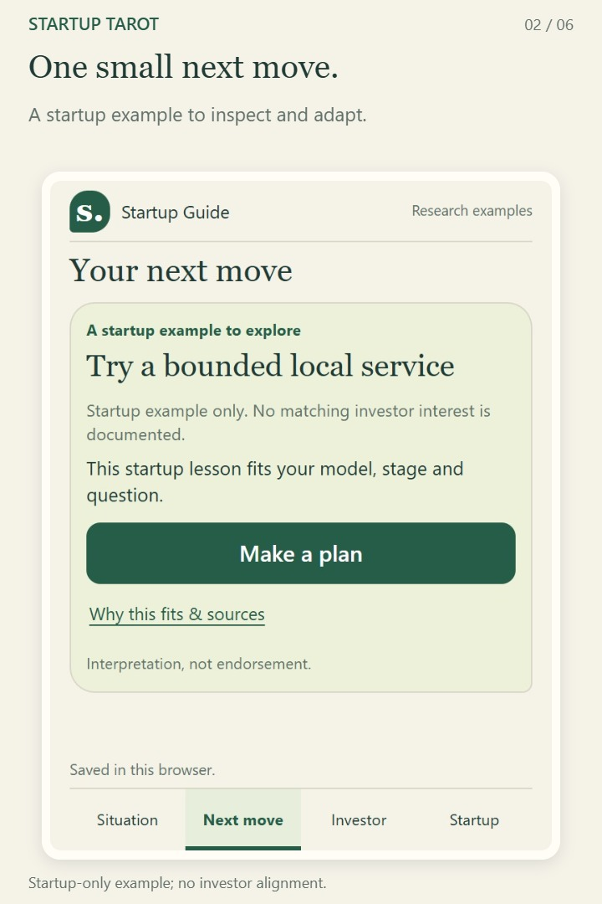

# Startup Tarot

**Choose a small experiment. Understand why. Record what you learn.**

[Watch the 29-second introduction](assets/startup-tarot-intro.mp4) · Silent, with captions · [Caption file](assets/startup-tarot-intro.vtt)

1. [Download the app](https://github.com/hmc62843u/startup-tarot/archive/refs/heads/main.zip), unzip it and open **index.html**. No installation, Node or Python needed.
2. Describe your **Situation** with three choices.
3. Review your **Next move**, adapt a plan and save it.

| Situation | Next move | Investor | Startup |
| --- | --- | --- | --- |
| Where you are | What to try next | One investor perspective | One dated startup example |

Browse investors and startups with the arrows. Related startup examples appear first; others are labelled browsing-only. Sources and limitations open on demand. Plans and notes stay in your browser.

Research is included. A startup-only example has no documented investor alignment. Connections describe relevance, not funding relationships, endorsement or what caused success.

[Use and test the app](GUIDE.md) · [Replace the local pack](GUIDE.md#the-local-pack) · [Create a Guide Pack](https://github.com/hmc62843u/guide-pack-kit) · [App development](DEVELOPMENT.md)

Code and original fictional examples: [MIT](LICENSE). Included research retains its [separate licence and source notices](packs/README.md). [Data scope](DATA_LICENSE.md).
