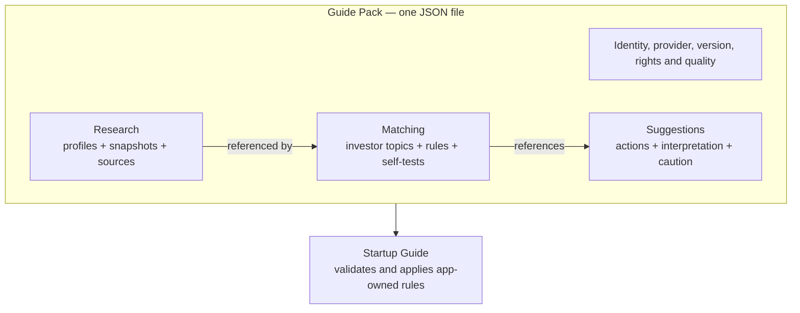
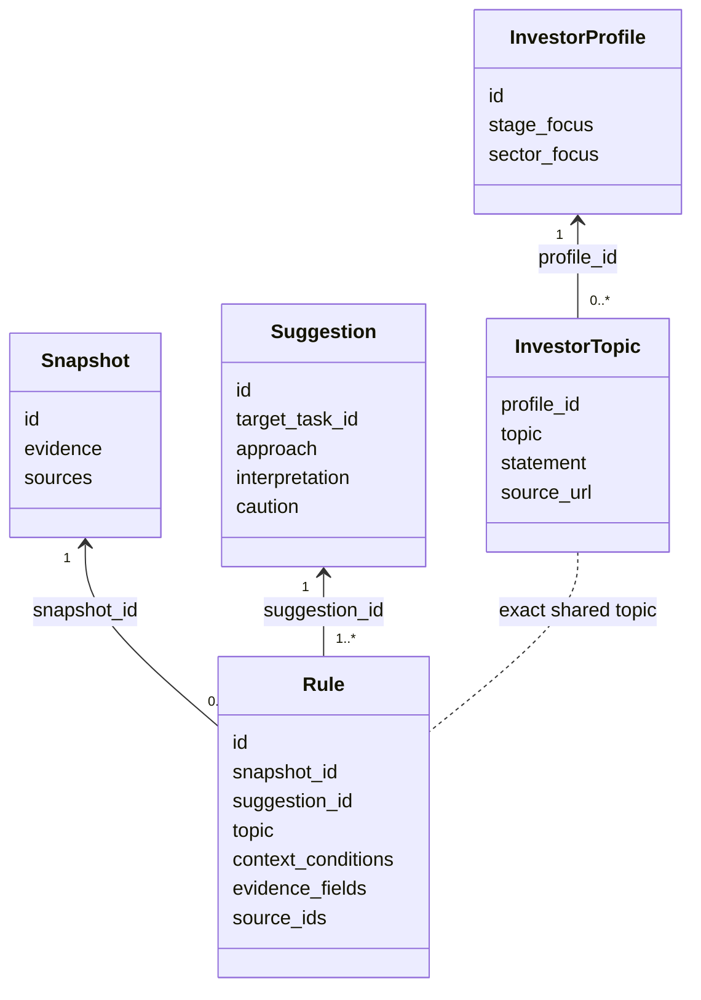
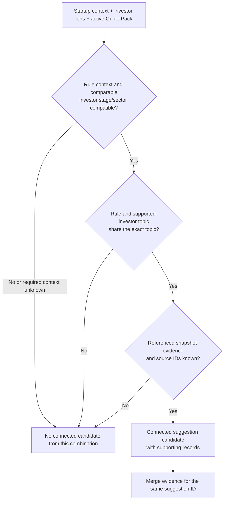
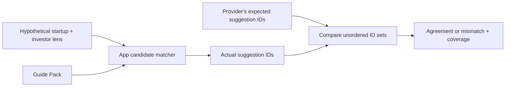

# Guide Pack format

This kit targets startup-guide's v2 contract. The exact shape is in schema/guide-pack-v2.schema.json; the app's GUIDE_PACKS.md describes constraints and examples. Runtime validation additionally checks dates, references, supported contexts and source URLs. Schemas are format references, not factual or legal approval.

## Three components, one JSON

| Component | Editable source in this kit | Responsibility |
| --- | --- | --- |
| `components.research` | `profiles/` and `startups/`, selected by `catalog.json` | Facts, sources, dates, unknowns and limitations. |
| `components.matching` | `components/matching.json` | Investor-topic connections, rule conditions and optional expected-result cases. |
| `components.suggestions` | `components/suggestions.json` | Action text, interpretation and cautions. |

Combine `package-metadata.json` with these components. Preserve `schema_version:2`, stable library identity, semantic version, update date, provider identity, `dataset_kind`, optional repository URL, licence, rights review and quality declarations. Local URLs can be null; do not invent repository addresses or publish filesystem paths. Research records require `data_kind:research`; do not embed `preparation_topics` or `preparation_lessons`.

Quality declarations cover research, matching and suggestions. Each has `status` and `statement`; status is `not_evaluated`, `self_reviewed` or `independent_review`. Evaluated claims require an actual `reviewed_date`. These are provider declarations, not app-certified ratings. A structural pass does not authenticate a provider or establish research truth or usefulness.

## How the records connect

This UML view shows the main references, not every JSON field. A line means a declared relationship, not proof of causality or a historical investment relationship.

`evidence`, `context_conditions` and the profile focus labels summarize concepts; use the schema for exact field names and nesting. There is no direct foreign key from a rule to an investor-topic record: they meet through a shared `topic` and compatibility checks.

| Concept | What it means in this format |
| --- | --- |
| Criteria / guidance | Source-supported investor interest summarized by an investor-topic `statement`; not separate record types. |
| Topic | Shared matching value on investor topics and rules; not a standalone record. |
| Startup context | Runtime input: business model, stage, learning focus and sectors. Also supplied as hypothetical input in self-tests. |
| Investor lens | Selected profile IDs, or an unselected lens allowing preview across comparable profiles. |
| Stage / sector focus | Compatibility inputs; compatibility alone does not establish an investor learning priority. |
| Sources / evidence | Research support and its dates, unknowns and limitations. Rules cite known snapshot fields and source IDs. |
| Task | An app-defined destination referenced by `target_task_id`; a pack cannot add executable task types. |
| Interpretation / caution | Authored suggestion fields, distinct from source facts and investor requirements. |
| Evaluation case | Hypothetical context, lens and expected suggestion IDs used to check candidate matching. |

## How matching works

This is a conceptual activity view of candidate eligibility, not JavaScript execution order. The app examines eligible combinations; one failed combination does not prevent another from matching. A selected lens restricts profiles; an unselected lens permits preview without choosing one. Candidate matching does not determine Home ordering or prove usefulness, funding or survival.

Self-tests pass hypothetical inputs through this same matcher and compare expected with actual suggestion IDs. Their detailed contract is below.

## Connection requirements

| Record | Required fields | References and evidence requirements |
| --- | --- | --- |
| Investor topic | `profile_id`, `topic`, `statement`, `source_url`, `published_date`, `retrieved_date` | Existing profile; unique profile/topic pair; statement accurately summarizes source-supported investor criteria or guidance. Dates use `YYYY-MM-DD`; research URLs use HTTP/HTTPS without credentials. |
| Rule | `id`, `type`, `snapshot_id`, `suggestion_id`, `topic`, `business_models`, `startup_stages`, `validation_focus`, `evidence_fields`, `source_ids` | Existing snapshot and suggestion; known evidence fields citing the listed source IDs. Only `type:context_topic_v1` is supported. Context arrays are nonempty. |
| Suggestion | `id`, `title`, `target_task_id`, `approach`, `interpretation`, `caution` | At least one referencing rule; app-defined task ID. Reuse an ID only for the same action: rules across snapshots merge supporting evidence. |

| Constraint | Supported values |
| --- | --- |
| Business model | `marketplace`, `service`, `saas`, `hardware`, `consumer_product`, `other` |
| Startup stage | `pre-company`, `idea`, `pre-seed`, `seed`, `series-a`, `growth` |
| Learning focus | `customer_problem`, `demand`, `operations`, `technical_feasibility` |
| Evidence field | `product`, `customers`, `team`, `funding` |
| Target task | `suggestion:customer-evidence`, `suggestion:next-milestone`, `suggestion:team-evidence`, `suggestion:product-evidence` |

**Valid but unmatched:** a rule can remain dormant when no supported investor topic shares its topic. Past investments and stage/sector compatibility alone do not establish that topic. Do not invent a connection to force a match.

**Invalid structure:** missing references or unsupported fields/operators fail validation. Providers cannot bypass checks or supply code, arbitrary expressions, scoring operators or model calls.

Interpretation is authored reasoning, not an investor requirement or survival explanation. Historical counts are not targets.

## Matching self-tests

Optional `components.matching.evaluation_cases` checks whether the app's candidate matcher returns the suggestion IDs the provider expects.

| Part of each case | Requirements |
| --- | --- |
| Identity | `id`, `name`, `rationale`: unique simple lowercase ID; nonempty provider-authored name and rationale. |
| Startup input | `startup` contains exactly `business_model`, `current_stage`, `validation_focus`, `sectors`. Model/stage/focus use supported values above or `null` for unknown. Sectors: up to 20 nonempty strings. |
| Investor lens | `investor_ids`: unique existing profile IDs. `[]` means an unselected lens, allowing preview across comparable profiles. |
| Expected output | `expected_suggestion_ids`: unique existing suggestion IDs. `[]` expects no connected suggestion. |

These are hypothetical inputs, not additional historical startup facts. The app uses the same candidate matcher with fresh decisions for each case and displays expected/actual actions and coverage. Providers cannot supply evaluator code, arbitrary operators or hidden pass/fail functions.

| Coverage to include | What it checks |
| --- | --- |
| Positive | A supported connection produces the expected suggestion IDs. |
| Negative | An incompatible context or missing investor topic produces no connected suggestion. |
| Unknown context | Missing context does not silently become a supported match. |

Use these cases where the research supports them. Do not invent investor topics or research claims to force positive coverage. The current Research Guide Pack has no supported investor-topic connections; the separate fictional demo demonstrates positive cases.

| Result or limit | Meaning |
| --- | --- |
| Maximum 50 cases | Cases are optional. Packs without them remain compatible; running them requires the current app. |
| No cases | No measured result. |
| All cases expect no match | No positive coverage, even if every expectation agrees. |
| Agreement | Provider-authored self-test agreement, not an independent accuracy measurement. |
| Mismatch | Shown for review. A structurally valid pack can still be explicitly activated; a provider expectation is not automatically the correct answer. |
| Malformed case or reference | Validation blocks import; this differs from a valid case whose expectation disagrees. |
| Outside scope | Home ordering, progress decisions, research truth, causality and suggestion usefulness. |

Increase the package version when cases change. Establish expectations before running them; evaluate source quality and usefulness separately as described below.

## Package boundaries

Maximum 5 MB; at least one fact record; at most 250 profiles, 250 snapshots, 500 investor topics, 500 rules and 500 suggestions. Record IDs are unique within their arrays; rule and suggestion IDs are unique simple 3–64-character lowercase IDs starting with a letter. Fictional demo packages require dataset_kind:fictional and fictional records throughout. Do not disguise real records as invented examples.

V1 packages still work in the app but lack provider and quality metadata. The app materializes v2 components into its existing matching view without executing imported code or mutating package facts. A new operator needs changes in startup-guide. One active package at a time; workspace notes are separated by provider ID, library ID and version. IDs are declared, not authenticated.

## Evaluation and review

Check research support against actual sources. Establish expected match/nonmatch/unknown cases before running them. Evaluate suggestion clarity and learning value with users separately. Record sample sizes and actual results; do not claim accuracy from a passing format check. The app's tests check particular behaviors, not universal correctness or startup success.

Review changed facts, annotations and distribution terms; maintain exact saved-byte hashes in review-register.json and source notices in SOURCES.md. Increase the package version for changed JSON. Import and preview in startup-guide, activate explicitly, inspect evidence, test matching and nonmatching situations, reload and switch libraries. Report unperformed checks honestly. Do not publish or push unless requested.

## Authoring layout

`AUTHORING_PROMPT.md` coordinates focused stages in `prompts/`; `CONTRIBUTING.md` maps quality goals to extension points and review methods. These authoring modules do not change the JSON contract or allow imported executable code.

The kit uses catalog.json to select research records by root-relative paths, schema/ for format definitions, components/ for the decision recipe and suggestions, package-metadata.json for declarations, and dist/guide-pack.json as the complete deliverable. Keep provider and library IDs stable when renaming products; the existing starter IDs are retained for workspace compatibility. Edit this contract in guide-pack-kit, then refresh its copy in startup-guide/packs/ together with the package and notices.
